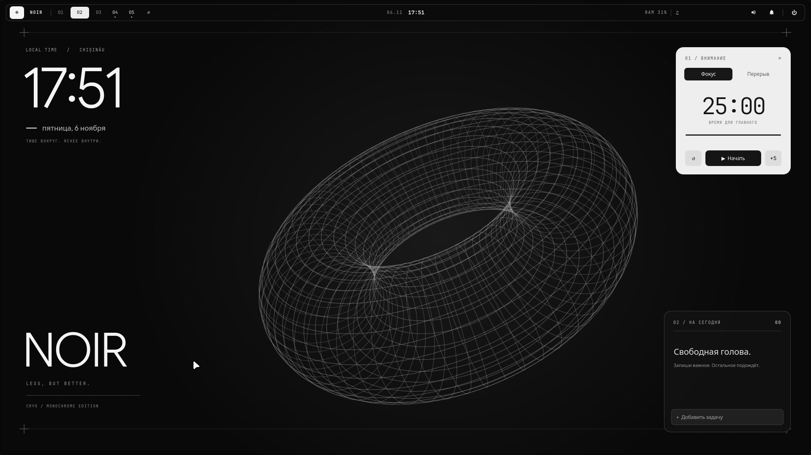

# NOIR — Caelestia, in black and white

A monochrome Hyprland desktop based on [Caelestia](https://github.com/caelestia-dots/caelestia), with a custom Quickshell panel, desktop widgets and original orbital wallpaper.



## What is included

- Floating panel on both monitors, with workspace indicators, clock, memory usage, media controls, audio, notifications and session menu.
- Large desktop clock, focus/break timer with persistent state, and a task list.
- Grayscale palette, thin window borders, soft shadows and short animations.
- Matching Foot, Fish, Starship, Fuzzel, GTK and Qt configuration.
- Original 3840 × 2160 wallpaper, editable SVG and palette.
- The current US/Russian keyboard layout, game rules and tablet mapping.

The original Caelestia files and Git history are retained. The NOIR profile is in [`noir/`](noir/); the original documentation is in [README.upstream.md](README.upstream.md). This fork changes the dotfiles and adds a separate panel; it uses the existing Caelestia shell and CLI.

## Requirements

Tested on NixOS with Hyprland 0.55.4 using Lua configuration, Quickshell 0.3.2, and Caelestia shell 1.0.0. Start from a working Caelestia installation. This repository does not install system packages or rebuild NixOS.

Use Python 3.11+, Fish, Foot, Starship, Fuzzel, Quickshell, Caelestia CLI/shell, `notify-send`, and a working PipeWire session. The profile uses **Google Sans Flex**, **JetBrainsMono Nerd Font**, **adw-gtk3-dark**, **Darkly/qtengine**, and the **Bibata Modern Ice** cursor. Install these separately or change their names in the configs. Standard XDG home directories are used.

## Install the current profile

Clone this fork and enter its directory, then inspect the destination list:

```bash
python3 noir/install.py --check
python3 noir/install.py --dry-run
```

This is a snapshot of a particular desktop. Before installing on another computer, edit [`noir/config/caelestia/hypr-user.lua`](noir/config/caelestia/hypr-user.lua): the main monitor is **DP-1, 1920 × 1080 at 180 Hz**, and the second monitor is **HDMI-A-1, 1440 × 900**, positioned to the left. The file also contains CS2/osu! rules, Wacom/OTD mapping and an OTD service startup. Desktop widgets select DP-1, falling back to the first available screen. Weather and the clock label use Chișinău.

```bash
python3 noir/install.py
```

The installer backs up every file it replaces under `~/.local/state/noir/backups/`, then installs the profile. It does not reload Hyprland or run system commands. Log out and back in, or apply the UI in the current session:

```bash
~/.local/bin/noir-panel
hyprctl reload config-only
```

The panel and polkit launchers detect available executables rather than embedding a particular Nix store hash. Existing tasks and timer state stay in `~/.local/state/purple-desktop/`; that legacy directory name is retained for compatibility. Runtime task contents are not part of the repository.

## Restore

Use the backup path printed by the installer:

```bash
python3 noir/install.py --restore ~/.local/state/noir/backups/<timestamp>
```

Log out and back in after restoring to restart the original panel. The restore operation leaves task contents and timer state intact.

## Controls and checks

The diamond opens applications; numbered buttons switch workspaces; the clock opens the dashboard. Scroll over the volume icon to adjust volume. The timer supports focus/break modes, pause, reset and adding five minutes. Click a task to complete it.

The top panel sits above Caelestia's transparent edge gesture region, so buttons work on empty workspaces regardless of process startup order. It hides over fullscreen windows.

The current desktop passed 14 real Wayland pointer click checks across both monitors, covering applications, dashboard, clock, audio menu, notifications, session menu and workspace switching. Hyprland reports no config errors; Foot, Fish and Starship configuration checks pass. These runtime checks cover the original NixOS machine; other distributions have not been tested.

## Updates and license

`caelestia update` manages upstream files and generated theme files; reapply the NOIR profile after such updates if they overwrite its colors. To keep a strict monochrome palette, keep `services.smartScheme` disabled and avoid replacing the saved palette with another scheme.

Caelestia's GPL-3.0 license and original attribution are retained in [LICENSE](LICENSE). NOIR additions are distributed under the same license. See [the upstream project](https://github.com/caelestia-dots/caelestia) for base installation, all keybindings and package integration.
